## Today

1. **What a Quarto dashboard is**: one `.qmd` file that becomes a dashboard
2. **Layout**: pages, rows, columns, sidebars, tabs
3. **Content**: plots, value boxes, tables, text, images, buttons
4. **Interactivity**: add Shiny inputs with `server: shiny`
5. **Publish**: GitHub Pages or Posit Connect Cloud

. . .

All examples use the Titanic data and come from the [project templates](../assignments/final/dashboard_project.html). Every code example is followed by a screenshot of the dashboard it makes.

## Static or interactive?

A Quarto dashboard can be either. One line in the YAML decides.

|  | **Static** | **Interactive** |
|:---|:---|:---|
| YAML | `format: dashboard` | `format: dashboard` <br> `server: shiny` |
| Output | one HTML file | a Shiny app |
| Button in RStudio | **Render** | **Run Document** |
| Readers can | hover, zoom, search tables | change inputs and re-run R code |
| Publish on | GitHub Pages | Posit Connect Cloud |

. . .

::: {.callout-tip}
Start static. Add `server: shiny` only when a reader's choice must re-run R code, for example filtering the data with a slider.
:::

# Part 1: Layout {background-color="#2c3e50"}

## Your first dashboard

:::: {.columns}
::: {.column width="57%"}
````{.markdown}
---
title: "My First Dashboard"
format: dashboard
---

```{{r}}
#| include: false
library(tidyverse)
url <- paste0("https://bryantstats.github.io/math421/",
              "data/titanic_final.csv")
df <- read_csv(url) |>
  mutate(Survived = factor(Survived,
                           labels = c("No", "Yes")),
         Pclass = factor(Pclass))
```

## Row

```{{r}}
#| title: Survival by class
ggplot(df, aes(x = Pclass, fill = Survived)) +
  geom_bar()
```

```{{r}}
#| title: Age
ggplot(df, aes(x = Age)) +
  geom_histogram()
```
````
:::

::: {.column width="43%"}
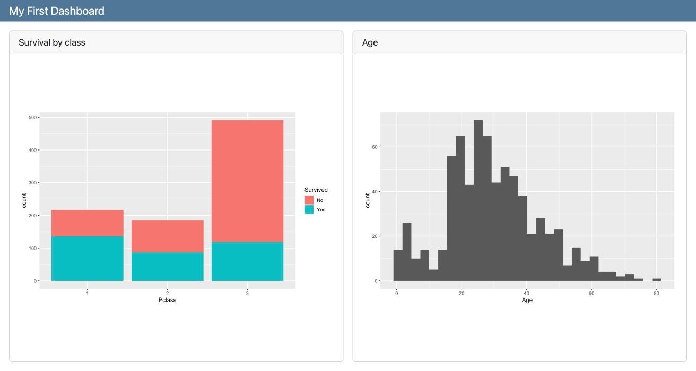

- `format: dashboard` turns the document into a dashboard.
- **Each code chunk becomes a card.** `#| title:` gives the card a title.
- `#| include: false` runs the setup chunk without making a card.
- Two chunks in the same `## Row` sit side by side.
:::
::::

[Code](quarto_dashboards_demo/first.qmd) · [Dashboard](quarto_dashboards_demo/first.html)

## Pages, rows, and columns

The number of `#` decides what a heading does.

| Heading | Makes |
|:---|:---|
| `# Overview` | a **page**: a tab in the navigation bar |
| `## Row` | a row of cards, side by side |
| `## Column` | a column of cards, stacked |
| `### Column` inside a `## Row` | a column nested in that row (and the other way around) |

Size them with attributes: `## Row {height=30%}`, `### Column {width=60%}`.

By default the top level is **rows**. Add `orientation: columns` under `dashboard:` in the YAML to start with columns.

## Layout example

:::: {.columns}
::: {.column width="40%"}
````{.markdown}
---
title: "Layout"
format: dashboard
---

# Overview

## Row {height=30%}

::: {.card title="Card A"}
Row 1, first card
:::

::: {.card title="Card B"}
Row 1, second card
:::

## Row {height=70%}

### Column {width=60%}

::: {.card title="Card C"}
Row 2, left column (60% wide)
:::

### Column {width=40%}

::: {.card title="Card D"}
Row 2, right column, top
:::

::: {.card title="Card E"}
Row 2, right column, bottom
:::

# Details

::: {.card title="Card F"}
A second page
:::
````
:::

::: {.column width="60%"}
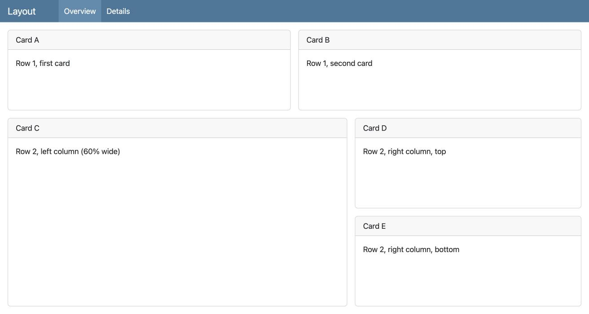

- `# Overview` and `# Details` are the two tabs in the navigation bar.
- Row 1 holds cards A and B side by side.
- Row 2 is split into two columns: C on the left (60%), D and E stacked on the right (40%).
- `::: {.card title="..."}` makes a card from plain text, with no code.
:::
::::

[Code](quarto_dashboards_demo/layout.qmd) · [Dashboard](quarto_dashboards_demo/layout.html)

## Sidebars

:::: {.columns}
::: {.column width="40%"}
````{.markdown}
# Overview

## {.sidebar}

The sinking of the Titanic is one
of the most infamous shipwrecks
in history.

## Column

### Row {height=25%}

(value boxes)

### Row {height=75%}

(plots)
````
:::

::: {.column width="60%"}


Put a sidebar on a page with `## {.sidebar}`. Text and inputs go inside it.
:::
::::

::: {.callout-warning}
On a page with a sidebar, the sections after it are laid out as **columns**, even if they are called `## Row`. To stack a row of value boxes above a row of plots, put both rows inside one `## Column`, as above.
:::

## Tabs

:::: {.columns}
::: {.column width="52%"}
````{.markdown}
# Distributions

## Column {.tabset}

```{{r}}
#| title: Age
p <- ggplot(df, aes(x = Age, color = Survived)) +
  geom_density()
ggplotly(p)
```

```{{r}}
#| title: Fare
p <- ggplot(df, aes(x = Fare, color = Survived)) +
  geom_density()
ggplotly(p)
```
````
:::

::: {.column width="48%"}
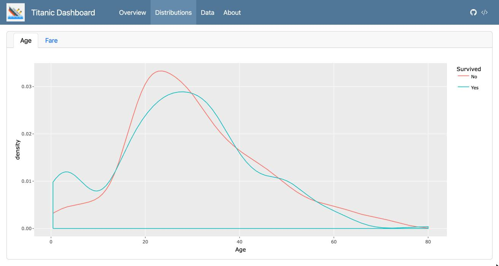

Add `{.tabset}` to a row or column. Each card in it becomes a tab, and the card titles (`Age`, `Fare`) become the tab names.
:::
::::

# Part 2: Content {background-color="#2c3e50"}

## Value boxes

```{.r}
#| content: valuebox
#| title: "Passengers"
list(icon = "people", color = "primary", value = nrow(df))
```

```{.r}
#| content: valuebox
#| title: "Survival rate"
list(icon = "life-preserver", color = "success",
     value = scales::percent(mean(df$Survived == "Yes"), accuracy = 1))
```

```{.r}
#| content: valuebox
#| title: "Median age"
list(icon = "person", color = "info", value = median(df$Age))
```

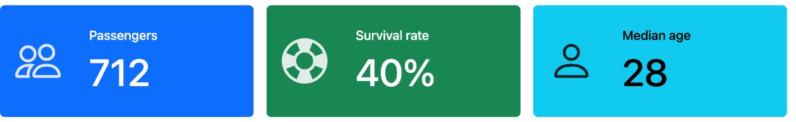

- `#| content: valuebox` turns a chunk into a big-number box. The chunk returns a `list()` with `value`, `icon`, and `color`.
- Icons: any name from [Bootstrap Icons](https://icons.getbootstrap.com/). Colors: `"primary"`, `"success"`, `"info"`, `"warning"`, `"danger"`, or a hex code.

## Interactive plots and tables

These work in a **static** dashboard. No server is needed.

:::: {.columns}
::: {.column width="58%"}
```{.r}
#| title: Survival by class
library(plotly)
p <- ggplot(df, aes(x = Pclass, fill = Survived)) +
  geom_bar(position = "fill")
ggplotly(p)        # hover, zoom, click the legend
```

```{.r}
#| title: Passenger data (type in the search box to filter)
library(DT)
df |>
  select(Name, Sex, Age, Pclass, Embarked, Fare, Survived) |>
  datatable(options = list(pageLength = 10))
```
:::

::: {.column width="42%"}
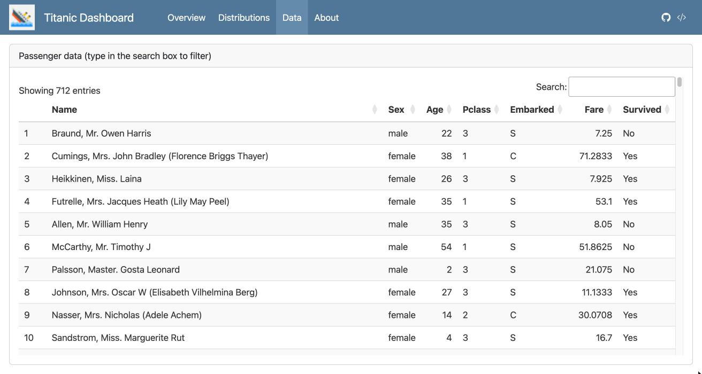

`datatable()` adds the search box, sortable columns, and pages. The `ggplotly()` plots are on the [static example](#/the-static-example).
:::
::::

## Text and images

````{.markdown}
# About

::: {.card title="About this dashboard"}

{width=60}

This dashboard was built with Quarto. The **Overview** page shows the main numbers,
**Distributions** compares age and fare for passengers who did and did not survive,
and **Data** lets you search the passenger list.

Women and first-class passengers survived at much higher rates than men and
third-class passengers.

:::
````

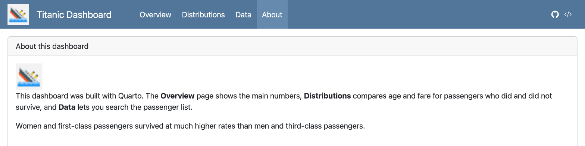

- Text in the sidebar or in a `.card` is plain Markdown: **bold**, lists, links.
- Use inline R to put numbers in text: `` `r nrow(df)` `` passengers.

## Logo and navigation buttons

```{.yaml}
format:
  dashboard:
    logo: logo.png
    nav-buttons:
      - icon: github
        href: https://github.com/bryantstats
        aria-label: GitHub profile
      - icon: code-slash
        href: https://raw.githubusercontent.com/bryantstats/math421/main/assignments/final/dashboard_templates/q2_static.qmd
        aria-label: Source code
```

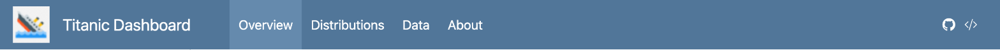

- `logo:` shows an image next to the title (left). Keep the image in the same folder.
- `nav-buttons:` adds icons at the top right.
  - **Social media:** `icon: linkedin` or `icon: github` with your profile link.
  - **Source code:** `icon: code-slash` with the **Raw** link of your `.qmd` on GitHub.

## The static example


Sidebar, value boxes, plotly plots, and four pages. [Dashboard](../assignments/final/dashboard_templates/q2_static.html) · [Code](../assignments/final/dashboard_templates/q2_static.qmd)

# Part 3: Interactivity {background-color="#2c3e50"}

## Add Shiny: three changes

:::: {.columns}
::: {.column width="58%"}
````{.markdown code-line-numbers="|4|7-16|20-25"}
---
title: "Titanic - selectInput"
format: dashboard
server: shiny
---

```{{r}}
#| context: setup
library(shiny)
library(tidyverse)
library(plotly)
library(DT)
url <- paste0("https://bryantstats.github.io/math421/",
              "data/titanic_final.csv")
df <- read_csv(url)
```

# Plots

## {.sidebar}

```{{r}}
selectInput("var", "Choose a variable",
            choices = c("Sex", "Pclass", "Embarked"))
```
````

1. `server: shiny` runs the dashboard with Shiny.
2. `#| context: setup` loads packages and data once.
3. Inputs go in the sidebar.
:::

::: {.column width="42%"}
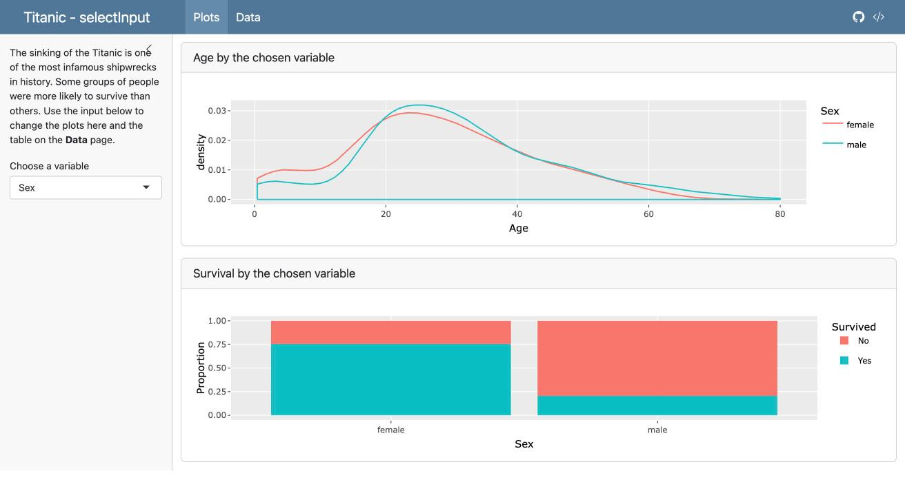

The full template, [1_select](../assignments/final/dashboard_templates/1_select.qmd). The **Choose a variable** box in the sidebar is the `selectInput()`.
:::
::::

## Outputs and the server chunk

:::: {.columns}
::: {.column width="50%"}
````{.markdown}
## Row

```{{r}}
#| title: Survival by the chosen variable
plotlyOutput("p2")
```

```{{r}}
#| context: server
output$p2 <- renderPlotly({
  p <- ggplot(df, aes(x = .data[[input$var]],
                      fill = Survived)) +
    geom_bar(position = "fill")
  ggplotly(p)
})
```
````
:::

::: {.column width="50%"}
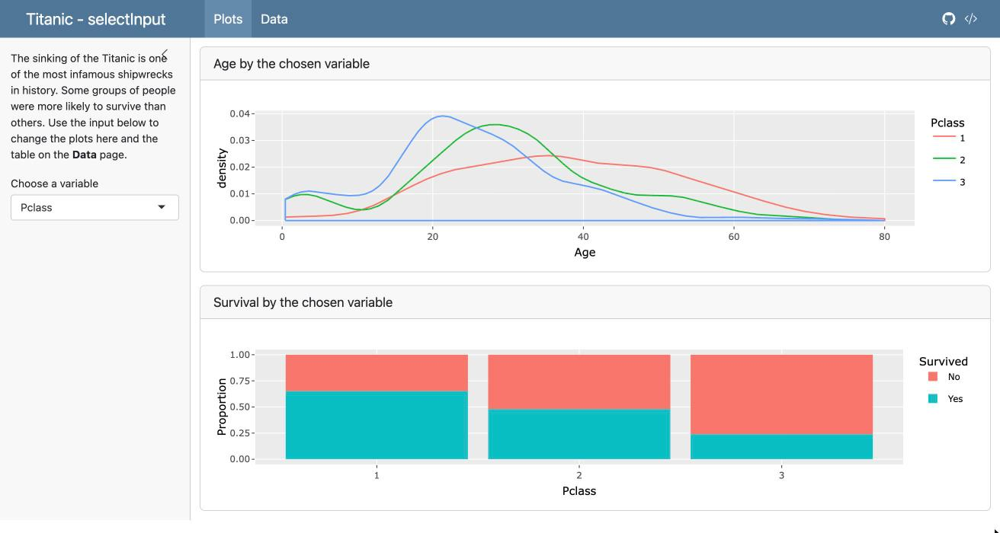

After choosing **Pclass**, both plots redraw by class.
:::
::::

- Output chunks hold **empty spaces**: `plotlyOutput()`, `DTOutput()`, `plotOutput()`, `textOutput()`.
- The `#| context: server` chunk **fills** them: `renderPlotly()`, `renderDT()`, `renderPlot()`, `renderText()`.
- The names must match: `plotlyOutput("p2")` ↔ `output$p2`. `input$var` is the current value of `selectInput("var", ...)`.

## Inputs

| Input | Gives `input$id` as | Template |
|:---|:---|:---|
| `selectInput("var", ...)` | one value | [1_select](../assignments/final/dashboard_templates/1_select.qmd) |
| `checkboxGroupInput("port", ...)` | several values | [2_checkbox](../assignments/final/dashboard_templates/2_checkbox.qmd) |
| `sliderInput("age", ..., value = c(0, 80))` | a range: `input$age[1]`, `input$age[2]` | [3_slider](../assignments/final/dashboard_templates/3_slider.qmd) |
| `radioButtons("pos", ...)` | one value | [4_radio](../assignments/final/dashboard_templates/4_radio.qmd) |
| `dateRangeInput("dates", ...)` | two dates | [5_date_range](../assignments/final/dashboard_templates/5_date_range.qmd) |

All five together: [6_combine](../assignments/final/dashboard_templates/6_combine.qmd)

## Inputs: code and result

:::: {.columns}
::: {.column width="68%"}
```{.r}
selectInput("var", "Group by",
            choices = c("Sex", "Pclass", "Embarked"))
checkboxGroupInput("port", "Port of embarkation",
                   choices = c("Cherbourg" = "C",
                               "Queenstown" = "Q",
                               "Southampton" = "S"),
                   selected = c("C", "Q", "S"))
sliderInput("age", "Age", min = 0, max = 80, value = c(0, 80))
radioButtons("pos", "Bar type",
             choices = c("Proportion" = "fill", "Count" = "stack"))
dateRangeInput("dates", "Date range",
               start = min(df$date), end = max(df$date),
               min = min(df$date), max = max(df$date))
```

- The first argument is the id: `input$var`, `input$port`, ...
- The second is the label shown above the input.
- `"Cherbourg" = "C"`: show *Cherbourg*, send `"C"` to `input$port`.
:::

::: {.column width="32%"}
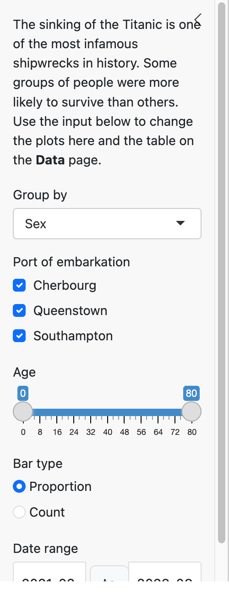
:::
::::

## Filter once with `reactive()`

```{.r}
#| context: server
filtered <- reactive({
  df |>
    filter(Embarked %in% input$port,
           Age >= input$age[1], Age <= input$age[2],
           date >= input$dates[1], date <= input$dates[2])
})

output$p1 <- renderPlotly({
  if (nrow(filtered()) == 0) return(empty_plot())
  p <- ggplot(filtered(), aes(x = Age, color = .data[[input$var]])) + geom_density()
  ggplotly(p)
})
```

:::: {.columns}
::: {.column width="50%"}
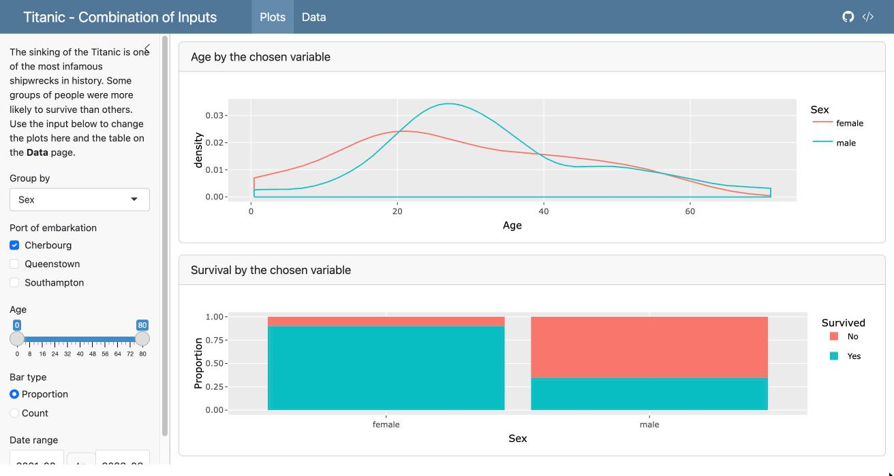

Only **Cherbourg** ticked: every plot uses the filtered data.
:::

::: {.column width="50%"}
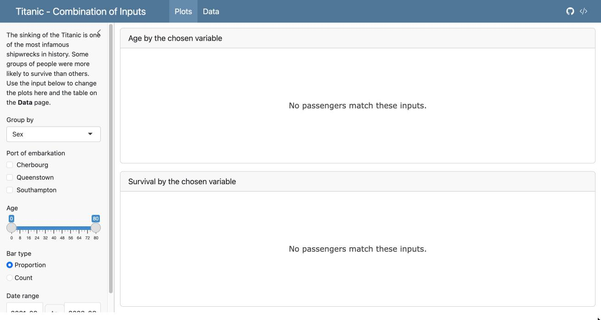

No port ticked: 0 rows, so `empty_plot()` shows a message.
:::
::::

- `reactive()` filters once; every output reuses it. Call it with **`filtered()`**.
- `empty_plot()` is defined in the setup chunk of the templates:

```{.r}
empty_plot <- function() {
  plotly_empty() |>
    layout(title = list(text = "No passengers match these inputs.", y = 0.5))
}
```

## The interactive example


Five input types on the **Plots** page; the **Data** page table follows the same inputs. [Dashboard](https://01a1c073-ceea-8236-dd38-2dc5028bec55.share.connect.posit.cloud/) · [Code](../assignments/final/dashboard_templates/6_combine.qmd)

# Part 4: Publish {background-color="#2c3e50"}

## Run it, then publish it

**Static dashboard** (no `server: shiny`)

- Click **Render**. You get an `.html` file plus a `_files` folder.
- Push both to GitHub and link the `.html` on your GitHub page, like your other assignments.

**Interactive dashboard** (`server: shiny`)

- Click **Run Document** to run it on your computer.
- Publish on [Posit Connect Cloud](https://connect.posit.cloud): click the blue **Publish** icon → **Posit Connect Cloud**.
- In the Publish dialog, tick only the `.qmd`, your data file, and your logo.

. . .

::: {.callout-important}
A free Connect Cloud account holds only a few apps. Create **two** accounts, connect both in RStudio (Tools → Global Options → Publishing), and pick one under **Publish from account** each time. Delete dashboards you no longer need: publishing to a full account fails and can break the apps already on it.
:::

## Common errors

| What you see | Usual cause |
|:---|:---|
| Cards in the wrong place | Wrong number of `#`; or a sidebar page where rows became columns |
| A plot stays the same after changing an input | Output id typo: `plotlyOutput("p1")` vs `output$p01` |
| `object 'filtered' not found` | Called `filtered` without `()` |
| `could not find function "selectInput"` | `library(shiny)` missing from the `setup` chunk |
| **Render** button runs but inputs do nothing | Interactive dashboards need **Run Document** |
| Works on your computer, fails after publishing | Data file not ticked in the Publish dialog, or a path like `C://Users/...` |
| `maximum applications limit` | Account full: delete old apps or use your second account |

## Practice

1. Render the [empty template](../assignments/final/dashboard_templates/0_empty.qmd). Rename the pages and cards.
2. In the [static template](../assignments/final/dashboard_templates/q2_static.qmd), add a fourth value box and a third tab on the **Distributions** page.
3. Change the `nav-buttons` to your own GitHub profile and source code link.
4. In [1_select](../assignments/final/dashboard_templates/1_select.qmd), add `"Survived"` to the choices. What happens to the bar chart, and why?
5. In [3_slider](../assignments/final/dashboard_templates/3_slider.qmd), add a second slider for `Fare` and use it in `filtered()`.

Then start the [Dashboard Project](../assignments/final/dashboard_project.html).

## References

- [Quarto dashboards: overview](https://quarto.org/docs/dashboards/)
- [Layout](https://quarto.org/docs/dashboards/layout.html) · [Data display](https://quarto.org/docs/dashboards/data-display.html) · [Inputs](https://quarto.org/docs/dashboards/inputs.html)
- [Dashboards with Shiny for R](https://quarto.org/docs/dashboards/interactivity/shiny-r.html)
- [Bootstrap Icons](https://icons.getbootstrap.com/) for value boxes and nav buttons
- [Deploy to Posit Connect Cloud](https://docs.posit.co/connect-cloud/how-to/r/shiny-r.html)
