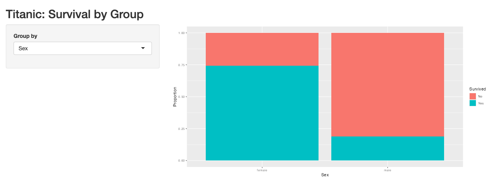
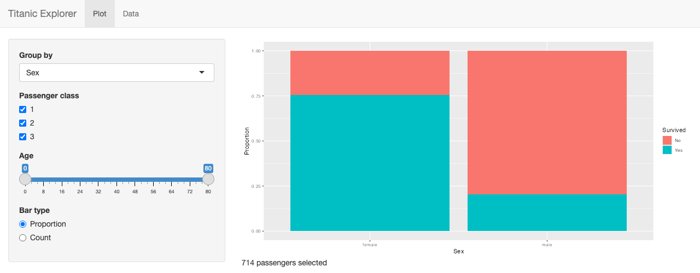
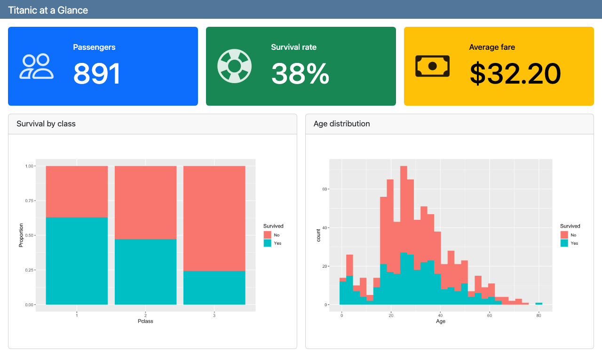
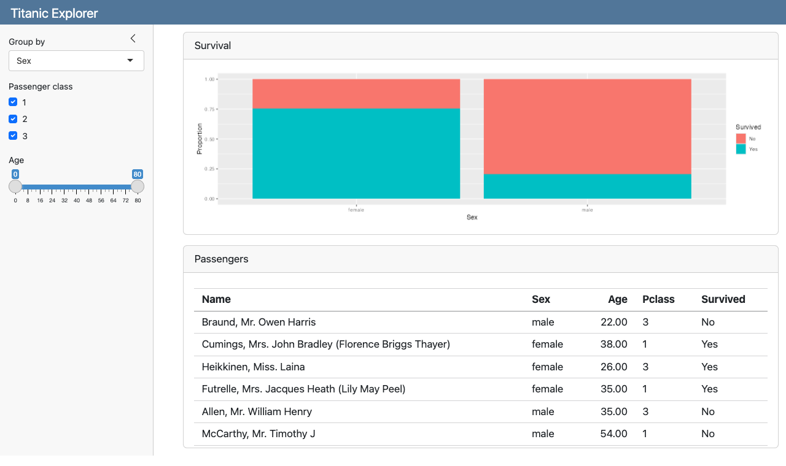

## Today

**Part 1: Shiny.** Build a web app with nothing but R code.

**Part 2: Quarto dashboards.** Lay out plots and numbers as a dashboard, then make it interactive with Shiny.

**Part 3: Publish and choose.** Put your app on the Internet, and decide which tool fits a project.

. . .

Every example uses the Titanic data and runs on your computer. The code is in the [`shiny_dashboards`](shiny_dashboards/) folder next to these slides.

| Folder | What it is |
|:---|:---|
| `1_shiny_basic` | Smallest useful Shiny app |
| `2_shiny_explorer` | Several inputs, `reactive()`, `navbarPage` |
| `3_dashboard_static` | Quarto dashboard, no Shiny |
| `4_dashboard_shiny` | Quarto dashboard + Shiny |

## Two tools, one idea

|  | **Shiny app** | **Quarto dashboard** |
|:---|:---|:---|
| File | `app.R` | `dashboard.qmd` |
| Layout | Written in R: `fluidPage()`, `sidebarLayout()` | Written in Markdown: `## Row`, `## Column` |
| Interactive? | Always | Only with `server: shiny` |
| Best for | Apps: filters, uploads, many pages | Reports with plots, numbers, a few filters |
| Run it | `Ctrl + Shift + Enter` | Render (static) or Run Document (Shiny) |

. . .

::: {.callout-tip}
An interactive Quarto dashboard **is** Shiny underneath. Learn Shiny first and dashboards become easy.
:::

# Part 1: Shiny {background-color="#2c3e50"}

## Every Shiny app has three parts

```{.r}
library(shiny)

ui <- fluidPage(
  # 1. UI: what the user sees (inputs and empty spaces for outputs)
)

server <- function(input, output) {
  # 2. Server: R code that fills those spaces
}

shinyApp(ui, server)   # 3. Put them together and run
```

. . .

- Save it as **`app.R`** in its own folder, with the data file next to it.
- Press **`Ctrl + Shift + Enter`** (Mac: `Cmd + Shift + Enter`) to run it.
- Read data with `read_csv("titanic.csv")`, never a path like `C://Users/...`.

## Example 1: survival by group

```{.r code-line-numbers="|12|14|19-23"}
library(shiny)
library(tidyverse)

titanic <- read_csv("titanic.csv") |>
  mutate(Survived = factor(Survived, labels = c("No", "Yes")),
         Pclass   = factor(Pclass))

ui <- fluidPage(
  titlePanel("Titanic: Survival by Group"),
  sidebarLayout(
    sidebarPanel(
      selectInput("var", "Group by", choices = c("Sex", "Pclass", "Embarked"))
    ),
    mainPanel(plotOutput("bar"))
  )
)

server <- function(input, output) {
  output$bar <- renderPlot({
    ggplot(titanic, aes(x = .data[[input$var]], fill = Survived)) +
      geom_bar(position = "fill") +
      labs(y = "Proportion")
  })
}

shinyApp(ui, server)
```

## Example 1: how the pieces connect

{width="80%"}

1. `selectInput("var", ...)` creates a dropdown. Its value is **`input$var`**.
2. `plotOutput("bar")` reserves a space named `"bar"`.
3. `output$bar <- renderPlot({...})` fills that space.
4. When the user picks a new variable, Shiny **re-runs** `renderPlot` automatically.

`.data[[input$var]]` turns the text `"Sex"` into the column `Sex` inside `aes()`.

## Inputs and outputs come in pairs

:::: {.columns}
::: {.column width="50%"}
**Inputs** (in `ui`)

| Function | Gives `input$id` as |
|:---|:---|
| `selectInput()` | one value |
| `checkboxGroupInput()` | several values |
| `sliderInput()` | number or range |
| `radioButtons()` | one value |
| `dateRangeInput()` | two dates |
| `fileInput()` | an uploaded file |
:::

::: {.column width="50%"}
**Outputs**: put the left one in `ui` and fill it with the right one in `server`

| `ui` | `server` |
|:---|:---|
| `plotOutput()` | `renderPlot()` |
| `tableOutput()` | `renderTable()` |
| `textOutput()` | `renderText()` |
| `uiOutput()` | `renderUI()` |
:::
::::

::: {.callout-warning}
The id must match exactly: `plotOutput("bar")` ↔ `output$bar`. A typo gives a blank space, not an error.
:::

## Example 2: more inputs (UI)

```{.r code-line-numbers="|1,2,15|5-10|12"}
ui <- navbarPage("Titanic Explorer",
  tabPanel("Plot",
    sidebarLayout(
      sidebarPanel(
        selectInput("var", "Group by", choices = c("Sex", "Pclass", "Embarked")),
        checkboxGroupInput("class", "Passenger class",
                           choices = c("1", "2", "3"), selected = c("1", "2", "3")),
        sliderInput("age", "Age", min = 0, max = 80, value = c(0, 80)),
        radioButtons("pos", "Bar type",
                     choices = c("Proportion" = "fill", "Count" = "stack"))
      ),
      mainPanel(plotOutput("bar"), textOutput("n"))
    )
  ),
  tabPanel("Data", tableOutput("tbl"))
)
```

- `navbarPage()` + `tabPanel()` give the app tabs across the top.
- A range slider gives **two** numbers: `input$age[1]` and `input$age[2]`.
- `radioButtons()` can show one label (`"Count"`) but send another value (`"stack"`).

## Example 2: `reactive()` (server)

```{.r code-line-numbers="|3-7|10,15,18"}
server <- function(input, output) {
  # Filter once, reuse in every output
  filtered <- reactive({
    titanic |>
      filter(Pclass %in% input$class,
             Age >= input$age[1], Age <= input$age[2])
  })

  output$bar <- renderPlot({
    ggplot(filtered(), aes(x = .data[[input$var]], fill = Survived)) +
      geom_bar(position = input$pos) +
      labs(y = if (input$pos == "fill") "Proportion" else "Count")
  })

  output$n <- renderText(paste(nrow(filtered()), "passengers selected"))

  output$tbl <- renderTable({
    filtered() |> select(Name, Sex, Age, Pclass, Survived) |> head(20)
  })
}
```

- `reactive()` is a **reusable result** that updates when its inputs change.
- Call it with parentheses: **`filtered()`**, not `filtered`.
- Without it, you would copy the same `filter()` into all three outputs.

## Example 2: the result



Untick class 3 or move the slider: the plot, the count, and the **Data** tab all update together.

# Part 2: Quarto Dashboards {background-color="#2c3e50"}

## A dashboard is a `.qmd` file

```{.markdown}
---
title: "Titanic at a Glance"
format: dashboard
---

## Row {height=25%}

(code chunks here become cards side by side)

## Row {height=75%}

(more code chunks)
```

- Each **code chunk** becomes a **card**. Give it a title with `#| title: ...`.
- `## Row` and `## Column` arrange the cards. `{height=...}` and `{width=...}` size them.
- `# Page name` (one `#`) makes separate pages; `## Row {.tabset}` makes tabs.
- Click **Render**. The result is an HTML file and needs no server.

## Example 3: value boxes

```{.r}
#| content: valuebox
#| title: "Passengers"
list(icon = "people", color = "primary", value = nrow(titanic))
```

```{.r}
#| content: valuebox
#| title: "Survival rate"
list(icon = "life-preserver", color = "success",
     value = scales::percent(mean(titanic$Survived == "Yes"), accuracy = 1))
```

- `#| content: valuebox` turns a chunk into a big-number box.
- The chunk returns a `list()` with `value`, an `icon`, and a `color`.
- Icons are names from [Bootstrap Icons](https://icons.getbootstrap.com/), e.g. `"people"`, `"cash"`.
- Colors: `"primary"`, `"success"`, `"warning"`, `"danger"`, `"info"`, or a hex code.

## Example 3: plots as cards

```{.r}
#| title: Survival by class
ggplot(titanic, aes(x = Pclass, fill = Survived)) +
  geom_bar(position = "fill") +
  labs(y = "Proportion")
```

```{.r}
#| title: Age distribution
ggplot(titanic, aes(x = Age, fill = Survived)) +
  geom_histogram(bins = 30)
```

Any R output works as a card: ggplot, plotly, a `knitr::kable()` table, a leaflet map.

## Example 3: the result



This dashboard is **static**: it looks the same for every visitor. To let them filter, add Shiny.

## Example 4: add Shiny to a dashboard

Three changes turn a static dashboard into an interactive one:

````{.markdown code-line-numbers="|4|7-11|13-17"}
---
title: "Titanic Explorer"
format: dashboard
server: shiny
---

```{{r}}
#| context: setup
library(shiny); library(tidyverse)
titanic <- read_csv("titanic.csv") |> mutate(...)
```

## {.sidebar}

```{{r}}
selectInput("var", "Group by", choices = c("Sex", "Pclass", "Embarked"))
```
````

1. `server: shiny` runs the dashboard with a Shiny server.
2. A `#| context: setup` chunk loads packages and data once.
3. Inputs go in a `## {.sidebar}` section.

## Example 4: outputs and server

```{.r}
#| title: Survival
plotOutput("bar")
```

```{.r}
#| context: server
filtered <- reactive({
  titanic |>
    filter(Pclass %in% input$class,
           Age >= input$age[1], Age <= input$age[2])
})

output$bar <- renderPlot({
  ggplot(filtered(), aes(x = .data[[input$var]], fill = Survived)) +
    geom_bar(position = "fill") +
    labs(y = "Proportion")
})
```

- Output chunks hold `plotOutput()`, `tableOutput()`, … exactly as in Shiny's `ui`.
- The `#| context: server` chunk is the body of Shiny's `server` function.
- Run it with **Run Document** in RStudio, or `quarto serve dashboard.qmd`.

## Example 4: the result



Same inputs and server code as Example 2. Quarto supplies the layout, cards, and sidebar.

## Same app, side by side

| Job | Shiny `app.R` | Quarto dashboard |
|:---|:---|:---|
| Load packages and data | top of `app.R` | `#| context: setup` chunk |
| Inputs | `sidebarPanel(...)` | `## {.sidebar}` + a chunk |
| Output spaces | `mainPanel(plotOutput("bar"))` | a chunk with `plotOutput("bar")` |
| Server code | `server <- function(input, output) {...}` | `#| context: server` chunk |
| Tabs / pages | `navbarPage()` + `tabPanel()` | `# Page` or `{.tabset}` |
| Run | `Ctrl + Shift + Enter` | Run Document / `quarto serve` |

. . .

`input$...`, `output$...`, `render*()`, and `reactive()` are **identical** in both.

# Part 3: Publish and Choose {background-color="#2c3e50"}

## Publish on Posit Connect Cloud

Posit Connect Cloud ([connect.posit.cloud](https://connect.posit.cloud)) replaces shinyapps.io. It hosts Shiny apps and Quarto dashboards.

**From RStudio** (version 2026.04 or newer)

1. Create a free account at connect.posit.cloud (sign up with GitHub).
2. Open `app.R` or `dashboard.qmd` and click the blue **Publish** icon.
3. Choose **Posit Connect Cloud**, sign in, and publish.

**From GitHub**

1. Put the app folder (code + data) in a **public** GitHub repository.
2. In that folder run `rsconnect::writeManifest()` and push `manifest.json`.
3. On connect.posit.cloud click **Publish**, choose the repository, branch, and main file.

::: {.callout-note}
A static dashboard (Example 3) is just HTML, so it can also go on GitHub Pages like your other assignments.
:::

## Which one should I use?

:::: {.columns}
::: {.column width="50%"}
**Shiny app** when you need

- many inputs that depend on each other
- file uploads (`fileInput()`)
- several pages of tools
- custom layout or behavior
- an app that will keep growing
:::

::: {.column width="50%"}
**Quarto dashboard** when you want

- a polished report with big numbers and plots
- a few filters on top of it
- no server at all (static)
- to reuse a Quarto report you already wrote
:::
::::

. . .

::: {.callout-tip}
Not sure? Start with a Shiny `app.R`. The same `server` code moves into a dashboard later almost unchanged.
:::

## Common errors

| What you see | Usual cause |
|:---|:---|
| Blank space where a plot should be | Output id typo: `plotOutput("bar")` vs `output$barr` |
| `object 'filtered' not found` or wrong result | Called `filtered` without `()` |
| `Can't access reactive value 'var' outside of reactive consumer` | Used `input$var` outside a `render*()` or `reactive()` |
| `could not find function "selectInput"` in a dashboard | `library(shiny)` missing from the `setup` chunk |
| Works locally, fails after publishing | Local file path (`C://...`) or data file not in the app folder |
| Plot empty after unticking every box | Filter returns 0 rows; check with `validate(need(...))` |

## Practice

1. Run all four examples. In Example 1, add `"Parch"` to the choices.
2. In Example 2, add a `sliderInput()` for `Fare` and use it in `filtered()`.
3. Turn Example 3 into **two pages**: `# Overview` (value boxes) and `# Plots` (the two plots).
4. In Example 4, add a card that shows how many passengers are selected (`textOutput()` in a chunk, `renderText()` in the server chunk).
5. Publish one app and one dashboard on Posit Connect Cloud and send the links.

## References

- Shiny: [Get started](https://shiny.posit.co/r/getstarted/) · [Gallery](https://shiny.posit.co/r/gallery/) · [Mastering Shiny (free book)](https://mastering-shiny.org)
- Quarto dashboards: [Overview](https://quarto.org/docs/dashboards/) · [Layout](https://quarto.org/docs/dashboards/layout.html) · [Using Shiny](https://quarto.org/docs/dashboards/interactivity/shiny-r.html)
- Publishing: [Deploy a Shiny app to Connect Cloud](https://docs.posit.co/connect-cloud/how-to/r/shiny-r.html)
- Icons for value boxes: [Bootstrap Icons](https://icons.getbootstrap.com/)
